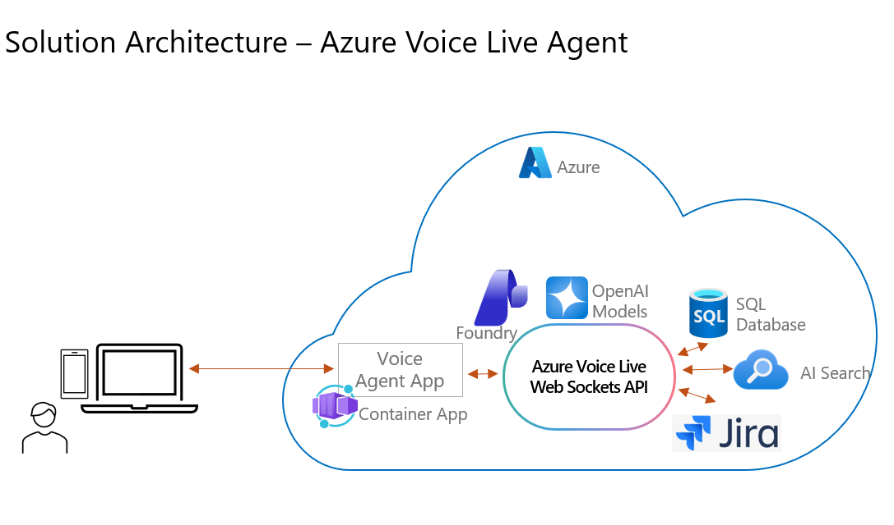
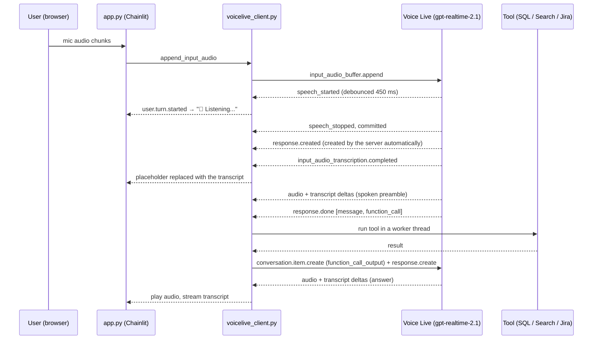

# Contoso Insurance Voice Agent — Azure Voice Live API + GPT-Realtime

A speech-to-speech AI assistant for **Contoso Insurance**, built on the **[Azure Voice Live API](https://learn.microsoft.com/azure/ai-services/speech-service/voice-live)** of a Microsoft Foundry resource and the `gpt-realtime-2.1` model. Customers talk to the assistant, or type, and it answers in natural speech with an Azure HD voice. A live transcript of both sides appears in a [Chainlit](https://docs.chainlit.io) web UI.

The assistant answers policy questions from a knowledge base, looks up the customer's insurance claims, and registers and tracks grievances. It does this through **client-side function calling** against Azure AI Search, Azure SQL Database and Atlassian Jira.

---

## Contents

- [Features](#features)
- [What you can ask](#what-you-can-ask)
- [Architecture](#architecture)
- [Project structure](#project-structure)
- [Prerequisites](#prerequisites)
- [Azure setup](#azure-setup)
- [Local setup and run](#local-setup-and-run)
- [Configuration reference](#configuration-reference)
- [Using the app](#using-the-app)
- [How it works](#how-it-works)
- [Handling coughs and brief noises](#handling-coughs-and-brief-noises)
- [Deploying to Azure](#deploying-to-azure)
- [Security notes](#security-notes)
- [Troubleshooting](#troubleshooting)
- [Known limitations](#known-limitations)
- [Changes from the previous version](#changes-from-the-previous-version)
- [References](#references)

---

## Features

- **Speech-to-speech conversation** over the Azure Voice Live API with `gpt-realtime-2.1`. It uses native audio understanding, and responses are spoken by an Azure HD neural voice (`en-IN-Meera:DragonHDV2.3Neural` by default).
- **Voice or text input**: the user can talk (server-side voice activity detection) or type in the chat box, in the same session and with the same conversation context.
- **Barge-in**: talk over the assistant to interrupt it. Playback stops, and the model's memory is truncated to what you actually heard.
- **Robust to coughs and background noise**: noise suppression, echo cancellation, Azure semantic VAD, a client-side interrupt debounce and noise-transcript filtering. Brief sounds don't break the response. See [Handling coughs and brief noises](#handling-coughs-and-brief-noises).
- **Keyless Azure authentication**: Voice Live, Azure AI Search and Azure SQL all use Microsoft Entra ID through `DefaultAzureCredential` (managed identity in Azure, `az login` locally). Only Jira uses an API token.
- **Correctly ordered live transcript**: user and assistant messages appear in conversational order, even though the server emits their transcripts asynchronously.
- **Solution configuration side panel**: shows the Voice Live model, transcription model, TTS voice, turn-detection settings and the Azure resources in use. The Atlassian API token and user name are redacted. It's collapsible and closed by default. A "Powered by Azure Voice Live in Microsoft Foundry" badge appears in the header.
- **Hindi and multilingual replies with a consistent persona**: the assistant speaks with a female voice (Meera) and uses feminine first-person grammar in Hindi ("मैं कर सकती हूँ", "मैं देख रही हूँ"). This is configurable with `ASSISTANT_GENDER`.
- **Containerized and deployed to Azure Container Apps** with a system-assigned managed identity, using an idempotent `az acr build` + `az containerapp` script.
- **Tools**:

  | Tool | What it does | Backend | Authentication |
  | --- | --- | --- | --- |
  | `perform_search_based_qna` | Answers questions on Contoso insurance products and policies | Azure AI Search, semantic ranking over the Contoso insurance FAQ index | Entra ID |
  | `get_claim_status_summary` | Summarizes the current customer's health insurance claims | Azure SQL Database, table `Health_Insurance_Claims` | Entra ID |
  | `register_user_grievance_def` | Registers a complaint as a Jira issue | Atlassian Jira Cloud | API token |
  | `get_grievance_status_def` | Gets the status, priority and due date of a grievance | Atlassian Jira Cloud | API token |

## What you can ask

- *"What types of health insurance plans does Contoso offer?"* → knowledge base (AI Search)
- *"How do I file a claim, and what documents do I need?"* → knowledge base
- *"What's the status of my claims?"* → Azure SQL
- *"I was charged twice for my premium this month, I want to raise a complaint."* → the assistant confirms the category and description, then creates a Jira issue and reads back the grievance id
- *"What's the status of grievance 10015?"* → Jira

## Architecture



Users talk to the **Voice Agent App**, a Chainlit web app running in **Azure Container Apps**. The app streams audio to the **Azure Voice Live WebSocket API** in **Microsoft Foundry**, which uses the OpenAI `gpt-realtime-2.1` model for speech-to-speech. When the model calls a tool, the app queries **Azure SQL Database** (claims), **Azure AI Search** (policy knowledge base) or **Jira** (grievances). Azure resources are accessed with the Container App's managed identity.

How the components connect inside the app:

```
┌──────────────────────────────┐
│ Browser — Chainlit UI        │  mic in / speaker out: pcm16 @ 24 kHz
└──────────────┬───────────────┘
               │ Chainlit websocket
┌──────────────▼───────────────┐
│ app.py                       │  system prompt, UI event handlers, audio/text entry points
└──────────────┬───────────────┘
               │ ordered UI event queue
┌──────────────▼───────────────┐      wss://<foundry>.cognitiveservices.azure.com/voice-live/realtime
│ voicelive_client.py          │ ───► ?api-version=2026-04-10&model=gpt-realtime-2.1
│  session config · events     │      Authorization: Bearer <Entra token, scope https://ai.azure.com/.default>
│  function calling · guards   │
└──────────────┬───────────────┘      Voice Live session:
               │                        azure_semantic_vad · azure_deep_noise_suppression
┌──────────────▼───────────────┐        server_echo_cancellation · gpt-4o-transcribe
│ tools.py / functions.py      │        Azure HD voice · tools
└──┬───────────┬───────────┬───┘
   │           │           │
Azure AI    Azure SQL    Jira Cloud
Search      Database     (API token)
(Entra ID)  (Entra ID)
```

A spoken question that needs a tool call:



## Project structure

| Path | Purpose |
| --- | --- |
| [app.py](app.py) | Chainlit app: system prompt, UI event handlers (placeholders, transcripts, playback, interrupts), mic/text entry points, session lifecycle |
| [voicelive_client.py](voicelive_client.py) | Voice Live WebSocket client: Entra-authenticated connection, `session.update` config, server event handling, response lifecycle tracking, function calling, interrupt debounce and stale-audio suppression |
| [tools.py](tools.py) | Tool (function) JSON schemas sent to the model, and the name → function dispatch table |
| [functions.py](functions.py) | Tool implementations: Azure AI Search, Azure SQL (Entra access token through pyodbc), Jira |
| [azure_auth.py](azure_auth.py) | Shared `DefaultAzureCredential`, per-scope token cache, `CachedTokenCredential` for Azure SDK clients, and token warm-up |
| [envconfig.py](envconfig.py) | All configuration, read from `.env` or environment variables, with defaults |
| [ui_config.py](ui_config.py) | Builds the solution configuration side panel (with secret and user-name redaction) and the "Powered by" text |
| [.chainlit/config.toml](.chainlit/config.toml) | Chainlit settings. `[features.audio] enabled = true` and `sample_rate = 24000` are required. Also sets the "Powered by" header link and the custom CSS. |
| [public/](public) | Header badge icon (`voice-live.svg`) and `custom.css` (wraps long values in the side panel) |
| [images/](images) | README images (solution architecture diagram) |
| [chainlit.md](chainlit.md) | Content of the in-app **Readme** panel |
| [Dockerfile](Dockerfile) | Container image: Python 3.12 slim + Microsoft ODBC Driver 18 (checked at build time), runs as non-root on port 8000 |
| [.dockerignore](.dockerignore) | Keeps `.env`, `.venv`, `.git`, `.azure`, tests and scripts out of the image |
| [scripts/deploy.ps1](scripts/deploy.ps1) | Builds with `az acr build` and deploys to Azure Container Apps (identity, RBAC, secrets, probes). Idempotent. |
| [scripts/grant_sql_access.py](scripts/grant_sql_access.py) | Creates the managed identity's contained database user and adds it to `db_datareader` |
| [scripts/pull-env.ps1](scripts/pull-env.ps1) | Recreates a local `.env`, including the Jira token, from the deployed Container App (for a new dev machine) |
| [tests/test_unit.py](tests/test_unit.py) | Offline unit tests (`python -m pytest`): cough debounce, barge-in, response lifecycle, tool deferral, noise filter, redaction, persona grammar, SQL transient errors |
| [tests/live/](tests/live) | Live tests against Azure: `e2e_voicelive.py` (tools, spoken input with coughs, interruption), `hindi_gender_check.py` (persona grammar), `ui_fake_mic_test.py` (browser with a fake microphone) |
| [.github/copilot-instructions.md](.github/copilot-instructions.md) | Project context, conventions and known pitfalls for GitHub Copilot / AI-assisted changes |
| [.azure/deployment-plan.md](.azure/deployment-plan.md) | Deployment plan with validation proof |
| [.env.example](.env.example) | Template for `.env` |
| [MESSAGE_SEQUENCING_IMPROVEMENTS.md](MESSAGE_SEQUENCING_IMPROVEMENTS.md) | Detailed notes on how transcript ordering is kept correct |
| [requirements.txt](requirements.txt) / [requirements-dev.txt](requirements-dev.txt) | Runtime dependencies / test tooling (pytest, playwright, numpy) |
| [pytest.ini](pytest.ini) | Limits `pytest` to the offline tests |

## Prerequisites

**Local tools**
- Python 3.10 or later (tested with 3.13)
- [ODBC Driver 18 for SQL Server](https://learn.microsoft.com/sql/connect/odbc/download-odbc-driver-for-sql-server)
- [Azure CLI](https://learn.microsoft.com/cli/azure/install-azure-cli), for `az login` during local development
- A browser with microphone access. Browsers only allow the microphone on `https://` or `http://localhost`.

**Azure resources**
- A **Microsoft Foundry** resource (kind `AIServices`) in a [region that supports Voice Live](https://learn.microsoft.com/azure/ai-services/speech-service/voice-live#supported-models-and-regions). `gpt-realtime-2.1` is one of the Voice Live managed models, so you don't need your own model deployment for it.
- **Azure AI Search** with an index over the Contoso insurance FAQ documents and a semantic configuration. Role-based access must be enabled (see [Azure setup](#azure-setup)).
- **Azure SQL Database** with Microsoft Entra authentication and the `Health_Insurance_Claims` table.

**Atlassian**
- A Jira Cloud site, a project for grievances, and an [API token](https://id.atlassian.com/manage-profile/security/api-tokens) for the account the app uses.

## Azure setup

### 1. Choose the identity

| Environment | Identity used by `DefaultAzureCredential` |
| --- | --- |
| Local development | Your `az login` (or VS Code Azure) account |
| Azure App Service / Container Apps / VM / AKS | The resource's **managed identity**. For a user-assigned identity, also set `AZURE_CLIENT_ID`. |

### 2. Assign roles to that identity

| Resource | Role / permission |
| --- | --- |
| Foundry resource | `Cognitive Services User` **and** `Foundry User`. `Foundry User` was previously named *Azure AI User*, and you may still see the old name. |
| Azure AI Search service | `Search Index Data Reader` |
| Azure SQL Database | A contained database user with `db_datareader` (step 4) |

```powershell
$principalId = "<object-id-of-user-or-managed-identity>"
az role assignment create --assignee $principalId --role "Cognitive Services User" --scope <foundry-resource-id>
az role assignment create --assignee $principalId --role "Foundry User"            --scope <foundry-resource-id>
az role assignment create --assignee $principalId --role "Search Index Data Reader" --scope <search-service-resource-id>
```

Role assignments can take a few minutes to take effect.

### 3. Enable role-based access on Azure AI Search

```powershell
az search service update --name <search-service> --resource-group <rg> `
  --auth-options aadOrApiKey --aad-auth-failure-mode http401WithBearerChallenge
```

### 4. Create the database user for the identity

Connect to the database as the server's **Microsoft Entra admin**, then run:

```sql
CREATE USER [<managed-identity-name or user@domain>] FROM EXTERNAL PROVIDER;
ALTER ROLE db_datareader ADD MEMBER [<managed-identity-name or user@domain>];
```

The server's firewall must allow the client: your IP for local runs, and *Allow Azure services* or a private endpoint or VNet for the hosted app.

### 5. Data the tools expect

**Azure SQL table `Health_Insurance_Claims`**

| Column | Type | Nullable |
| --- | --- | --- |
| `Claim_ID` | nvarchar(50) | no |
| `Patient_ID` | nvarchar(50) | no |
| `Provider_ID` | nvarchar(50) | no |
| `Date_of_Service` | date | no |
| `Date_Submitted` | date | no |
| `Service_Type` | nvarchar(50) | no |
| `Claim_Amount` | smallint | no |
| `Paid_Amount` | smallint | no |
| `Claim_Status` | nvarchar(50) | no |
| `Reason_for_Denial` | nvarchar(100) | yes |
| `Patient_Name` | nvarchar(50) | no |

`get_claim_status_summary` returns `Claim_ID`, `Service_Type`, `Claim_Amount`, `Claim_Status`, `Reason_for_Denial` and `Patient_Name` for rows `WHERE Patient_Name = <customer_name>`.

**Azure AI Search index**: the tool queries with `query_type="semantic"` and the configured semantic configuration, and reads the top 2 documents' `content` field. An index built by the Blob Storage indexer (fields `content`, `metadata_storage_name`, …) over the Contoso FAQ documents works as-is.

**Jira project**: grievances are created in the project `grievance_project_key` with issue type `grievance_type` (for example `Task`, which must exist in the project). The grievance id given to the customer is the numeric Jira issue **id** (for example `10015`), not the key (for example `DSS-12`).

## Local setup and run

```powershell
git clone <this-repo>
cd Realtime-Audio-Contoso-Insurance-Agent

python -m venv .venv
.\.venv\Scripts\Activate.ps1          # macOS/Linux: source .venv/bin/activate
pip install -r requirements.txt -r requirements-dev.txt

az login                              # the identity from "Azure setup"
pwsh ./scripts/pull-env.ps1           # recreate .env from the deployed app (or: Copy-Item .env.example .env, then edit)
chainlit run app.py
```

Open http://localhost:8000. Use `chainlit run app.py -w` to reload automatically on code changes.

### Continuing development on another machine

Everything needed to change, test and redeploy the app is in the repository. Only `.env` (which holds a secret) and the virtual environment aren't:

1. Install Python 3.10+, the [Azure CLI](https://learn.microsoft.com/cli/azure/install-azure-cli) (with `az extension add -n containerapp`), PowerShell 7 and [ODBC Driver 18 for SQL Server](https://learn.microsoft.com/sql/connect/odbc/download-odbc-driver-for-sql-server).
2. Clone the repo, create the venv and install both requirements files (see above).
3. `az login` with an account that has the [roles above](#2-assign-roles-to-that-identity) (for local runs), and write access to the Container App (for `pull-env.ps1`).
4. Run `pwsh ./scripts/pull-env.ps1` to rebuild `.env` from the deployed Container App's settings and secret. Docker isn't needed: images are built in ACR.
5. Check the setup with `python -m pytest` (offline), then `python tests/live/e2e_voicelive.py` (live).
6. Make your changes, re-run the tests, and redeploy with `pwsh ./scripts/deploy.ps1`.

[.github/copilot-instructions.md](.github/copilot-instructions.md) summarizes the architecture, conventions and known pitfalls, and GitHub Copilot picks it up automatically. [.azure/deployment-plan.md](.azure/deployment-plan.md) records how the current deployment was planned and validated.

### Tests

| Command | Needs Azure? | What it checks |
| --- | --- | --- |
| `python -m pytest` | No | 24 unit tests: cough debounce vs. real barge-in, stale-audio suppression, response lifecycle and tool-result deferral, function calls after a spoken preamble, watchdog, session close handling, noise-transcript filter, side-panel redaction, persona grammar, SQL transient-error classification |
| `python tests/live/e2e_voicelive.py` | Yes | Voice Live end to end: typed question → SQL tool; synthetic spoken question with injected coughs → Jira tool (coughs must not create user turns); a typed message interrupts an in-flight response |
| `python tests/live/hindi_gender_check.py` | Yes | Hindi replies use the persona's first-person grammatical gender even when the user says "आप … कर सकते हैं" |
| `python tests/live/ui_fake_mic_test.py --url <url>` | Yes | Drives the real UI in a headless browser with a WAV file as the microphone (speech + cough), then a typed question with the mic off. Run `python -m playwright install chromium` first, or pass `--channel msedge`. |

The live tests need `requirements-dev.txt` (numpy, playwright). They write artifacts such as the fake-mic WAV and screenshots to `tests/output/`, which is git-ignored.

## Configuration reference

All settings are read from `.env` (loaded by [envconfig.py](envconfig.py)) or from environment variables, such as App Service app settings.

**Azure Voice Live**

| Variable | Default | Description |
| --- | --- | --- |
| `AZURE_VOICE_LIVE_ENDPOINT` | *(required)* | Foundry resource endpoint: `https://<resource>.cognitiveservices.azure.com` or `https://<resource>.services.ai.azure.com`. The client builds the `wss://…/voice-live/realtime` URL from it. |
| `AZURE_VOICE_LIVE_API_VERSION` | `2026-04-10` | Voice Live API version |
| `VOICE_LIVE_MODEL` | `gpt-realtime-2.1` | Model name, for example `gpt-realtime-2.1-mini` for lower cost |
| `AZURE_TTS_VOICE_NAME` | `en-IN-Meera:DragonHDV2.3Neural` | Azure neural or HD voice for responses |
| `AZURE_TTS_VOICE_TEMPERATURE` | `0.8` | Variation in HD voice delivery |
| `INPUT_TRANSCRIPTION_MODEL` | `gpt-4o-transcribe` | Transcription of the user's audio: `gpt-4o-transcribe`, `gpt-4o-mini-transcribe`, `whisper-1`, `mai-transcribe` |

**Turn detection and noise robustness** (see [Handling coughs and brief noises](#handling-coughs-and-brief-noises))

| Variable | Default | Description |
| --- | --- | --- |
| `VAD_TYPE` | `azure_semantic_vad` | `azure_semantic_vad`, `azure_semantic_vad_multilingual` or `server_vad` |
| `VAD_THRESHOLD` | `0.6` | Speech confidence needed to start a turn (0.01–1.0; the service default is 0.5) |
| `VAD_PREFIX_PADDING_MS` | `300` | Audio kept before the detected start of speech |
| `VAD_SPEECH_DURATION_MS` | `300` | Minimum speech duration before a user turn starts (semantic VAD only) |
| `VAD_SILENCE_DURATION_MS` | `700` | Silence that ends the user's turn |
| `VAD_REMOVE_FILLER_WORDS` | `true` | Ignore "uh", "hmm", "yeah" and similar while the assistant is speaking (semantic VAD only) |
| `INTERRUPT_DEBOUNCE_MS` | `450` | How long speech must continue before playback is stopped on the client |

**Tools and identity**

| Variable | Default | Description |
| --- | --- | --- |
| `ai_search_url` | *(required)* | `https://<search>.search.windows.net` |
| `ai_index_name` | *(required)* | Index name, for example `contoso-insurance-faq-index` |
| `ai_semantic_config` | *(required)* | Semantic configuration name, for example `contoso-insurance-faq-config` |
| `az_db_server` | *(required)* | `<server>.database.windows.net` |
| `az_db_database` | *(required)* | Database name |
| `az_db_driver` | `ODBC Driver 18 for SQL Server` | ODBC driver name (installed in the container image) |
| `az_db_connection_timeout` | `60` | SQL login timeout in seconds. Kept generous so a cold start in Container Apps (first managed-identity token, gateway redirect) doesn't fail the first query. Transient errors are also retried up to 3 times with backoff. |
| `attlassian_url` | *(required)* | `https://<site>.atlassian.net/` |
| `attlassian_user_name` | *(required)* | Atlassian account email |
| `attlassian_api_key` | *(required)* | Atlassian API token (secret) |
| `grievance_project_key` | *(required)* | Jira project key for grievances |
| `grievance_type` | `Task` | Jira issue type for new grievances |
| `grievance_project_name` | — | Informational only; the code uses the project key |
| `customer_name` | `Srikantan` | The customer the assistant is talking to. Claim lookups are restricted to this patient, and the name is included in the system prompt. |
| `ASSISTANT_GENDER` | `female` | Gender of the assistant persona (`female` / `male`). It must match the TTS voice (Meera is female), because it sets the first-person grammar in Hindi and other gendered languages ("मैं कर सकती हूँ" vs "मैं कर सकता हूँ"). |
| `SHOW_CONFIG_PANEL_ON_START` | `false` | Open the solution configuration side panel automatically when a chat starts |
| `AZURE_CLIENT_ID` | — | Client id of a **user-assigned** managed identity, if you use one |
| `AZURE_TOKEN_CREDENTIALS` | — | Set to `ManagedIdentityCredential` by the deploy script, so the container goes straight to the managed identity without probing other credentials (faster cold start) |

## Using the app

- **Talk**: click the microphone icon (or press `P`), then speak. A `🎤 Listening...` bubble appears, changes to `🔄 Processing...`, and is then replaced by your transcript. The assistant's reply plays and streams as text.
- **Interrupt**: speak over the assistant for about half a second, or type a message. Playback stops and the assistant responds to the new input.
- **Type**: typed questions get a streamed transcript reply. They are also **spoken** if the microphone is on. Chainlit only sets up browser audio playback after the microphone has been started.
- **Session lifetime**: the Voice Live session opens on the first mic start or typed message. It stays open while you toggle the mic, so context is kept, and it closes when the chat ends (**New Chat** or closing the tab). If the service closes the session, for example after a long idle time, the app shows a notice and opens a new session on your next input. The previous conversation context isn't carried over.
- **Stop**: the Chainlit stop button cancels the response being generated.
- **Solution configuration**: the side panel is **collapsed by default**, so the chat uses the full width. Open or close it in any of these ways:
  - the **Show configuration** / **Hide configuration** buttons under the welcome message
  - the **settings** (gear) button in the message composer → **Show solution configuration panel** switch → *Confirm*. This stays reachable however far the chat has scrolled.
  - the ← arrow at the top of the panel, to close it
  
  Set `SHOW_CONFIG_PANEL_ON_START=true` to open it automatically for each new chat. The panel lists:
  - **Azure Voice Live · Microsoft Foundry**: resource, endpoint, API version, Voice Live model, transcription model, TTS voice, persona gender, voice temperature, auth method
  - **Turn detection & audio processing**: VAD type, threshold, silence and prefix padding, noise guards, barge-in debounce, noise suppression, echo cancellation, audio format
  - **Azure AI Search**, **Azure SQL Database** and **Jira**: endpoints, index, database, project, and auth method. The Jira API token is shown only as `•••••••• (configured)`, and the user name is masked (for example `ja••••••@c••••••.com`).
  - **Runtime**: whether the app runs as the Container App's managed identity or a developer sign-in, and the customer in scope
- **Readme**: the header **Readme** button shows a short in-app guide ([chainlit.md](chainlit.md)). The **Powered by Azure Voice Live in Microsoft Foundry** badge links to the Voice Live documentation.

## How it works

### Voice Live session configuration

After connecting, [voicelive_client.py](voicelive_client.py) sends a single `session.update` (values shown are the defaults):

```json
{
  "instructions": "<system prompt from app.py>",
  "modalities": ["text", "audio"],
  "input_audio_sampling_rate": 24000,
  "input_audio_format": "pcm16",
  "output_audio_format": "pcm16",
  "turn_detection": {
    "type": "azure_semantic_vad",
    "threshold": 0.6,
    "prefix_padding_ms": 300,
    "silence_duration_ms": 700,
    "speech_duration_ms": 300,
    "remove_filler_words": true,
    "interrupt_response": true,
    "auto_truncate": true
  },
  "input_audio_noise_reduction": { "type": "azure_deep_noise_suppression" },
  "input_audio_echo_cancellation": { "type": "server_echo_cancellation" },
  "input_audio_transcription": { "model": "gpt-4o-transcribe" },
  "voice": { "name": "en-IN-Meera:DragonHDV2.3Neural", "type": "azure-standard", "temperature": 0.8 },
  "tools": ["<see tools.py>"],
  "tool_choice": "auto"
}
```

### Authentication and token caching

- [azure_auth.py](azure_auth.py) creates one `DefaultAzureCredential` and caches an access token per scope until 5 minutes before it expires:
  - Voice Live: `https://ai.azure.com/.default`, sent as a `Bearer` header on the WebSocket handshake
  - Azure SQL: `https://database.windows.net/.default`, passed to pyodbc through `SQL_COPT_SS_ACCESS_TOKEN` (attribute 1256), with no password in the connection string
  - Azure AI Search: `https://search.azure.com/.default`, supplied to `SearchClient` through `CachedTokenCredential`
- Tokens are fetched ahead of time when a chat starts, so the first tool call doesn't wait for credential discovery.

### Function calling

- `gpt-realtime-2.1` often speaks a short preamble ("Let me check that for you…") **in the same response** as the function call. The function call is therefore not necessarily `response.output[0]`, so the client processes **every** `function_call` item in `response.done`.
- Tool functions do blocking I/O, so they run in a worker thread (`asyncio.to_thread`) and audio streaming isn't blocked.
- Each result is sent back as a `function_call_output` item, followed by one `response.create`.
- Tool errors are returned to the model as text, so it can tell the user rather than failing silently.

### Response lifecycle

- When VAD commits a user turn, the **server creates the response automatically** (`turn_detection.create_response` defaults to `true`). The client only sends `response.create` for typed messages and after function results.
- The client tracks each response through three states: *requested* (`response.create` sent, or audio committed), *active* (`response.created`), and *done* (`response.done`).
  - If a tool result is ready while another response is requested or active, for example because the user spoke during the tool call, the follow-up `response.create` is **deferred** until that response finishes. This way, a result never goes unanswered and there is no `conversation_already_has_active_response` error.
  - A watchdog resets the *requested* state if the service never acknowledges a request, so the session can't get stuck.
- Typed messages first cancel any in-flight response (`response.cancel`), wait for it to end, and then send the new message.

### Message sequencing

The server emits the user's transcript and the assistant's transcript asynchronously. To keep the chat in order:
- UI events go through a **single ordered queue**, so message sends, updates and audio chunks are applied in arrival order.
- A user placeholder is created as soon as a real user turn is detected, before the response begins. It's keyed by the server's user `item_id` and later replaced with the transcript.
- Assistant transcripts stream into a message keyed by the assistant `item_id`.
- After an interruption, remaining audio chunks from the interrupted response are dropped instead of playing late.

Details are in [MESSAGE_SEQUENCING_IMPROVEMENTS.md](MESSAGE_SEQUENCING_IMPROVEMENTS.md).

## Handling coughs and brief noises

In the earlier version, a cough or other short noise could be taken as user input. It would stop the assistant's audio mid-sentence or trigger a spurious new response. The app now protects against this in layers:

1. **Server-side noise suppression and echo cancellation**: `azure_deep_noise_suppression` removes non-speech background sound before VAD sees it. `server_echo_cancellation` stops the assistant's own voice (from speakers) from counting as user speech.
2. **Azure semantic VAD** (`azure_semantic_vad`) with:
   - `speech_duration_ms=300`: speech must last this long before a user turn starts, so short bursts are ignored.
   - `threshold=0.6`: needs a higher-confidence speech signal than the default of 0.5.
   - `remove_filler_words=true`: "uh", "hmm", "yeah" and similar don't barge in on an ongoing response.
   - `interrupt_response=true` and `auto_truncate=true`: real barge-in still works, and the model's memory is truncated to what the user heard.
3. **Client-side interrupt debounce** (ported from the [VoiceLiveAPI-Retail-Agent-Service-Demo](https://github.com/MSFT-Innovation-Hub-India/VoiceLiveAPI-Retail-Agent-Service-Demo) repo): on `input_audio_buffer.speech_started`, playback is **not** stopped immediately. It's stopped only if speech continues past `INTERRUPT_DEBOUNCE_MS` (450 ms), or if the server commits the audio as a real user turn (`input_audio_buffer.committed`). If `speech_stopped` arrives first, the pending interrupt is cancelled and nothing appears in the chat.
4. **Noise transcripts are dropped from the chat**: if a committed turn transcribes to nothing, or to a non-speech annotation such as `(coughs)` or `[noise]`, the user placeholder is removed. The system prompt also tells the model to ask the user to repeat instead of guessing.

**Tuning guide**

| Symptom | Adjust |
| --- | --- |
| Coughs or clicks still interrupt the assistant | Increase `VAD_SPEECH_DURATION_MS` (for example 400–500), `VAD_THRESHOLD` (for example 0.7) or `INTERRUPT_DEBOUNCE_MS` (for example 600) |
| Short answers like "yes" or "no" are missed | Decrease `VAD_SPEECH_DURATION_MS` (for example 200) or `VAD_THRESHOLD` (for example 0.5) |
| The assistant replies before the user has finished speaking | Increase `VAD_SILENCE_DURATION_MS` (for example 900–1200) |
| Replies feel slow to start | Decrease `VAD_SILENCE_DURATION_MS` (for example 500) |
| Barge-in feels sluggish | Decrease `INTERRUPT_DEBOUNCE_MS` (for example 300) |
| Speakers without headphones cause self-interruption | Keep `server_echo_cancellation` on, and use a headset or lower the speaker volume |
| Non-English or mixed-language users | `VAD_TYPE=azure_semantic_vad_multilingual`, and an appropriate `AZURE_TTS_VOICE_NAME` |

## Deploying to Azure

### Current deployment

| | |
| --- | --- |
| **URL** | https://contoso-insurance-voice-agent.whitemoss-1ee70859.southindia.azurecontainerapps.io |
| Container App | `contoso-insurance-voice-agent` (resource group `pcdotai-agent`) |
| Environment | Existing Container Apps environment `pcdotai-agent` (South India, Consumption, with Log Analytics attached) |
| Image | `pcdotaiagentd10b5a.azurecr.io/contoso-insurance-voice-agent:<timestamp>` (also tagged `latest`) |
| Identity | System-assigned managed identity |
| Compute | 1 vCPU / 2 GiB, 1–3 replicas, external ingress on port 8000 with sticky sessions |

### Deploy or update with one command

[scripts/deploy.ps1](scripts/deploy.ps1) is idempotent. Run it for the first deployment and for every code change:

```powershell
az login                                   # Owner/User Access Administrator on the target RGs + SQL Entra admin
pwsh ./scripts/deploy.ps1                  # build a new image and roll it out
pwsh ./scripts/deploy.ps1 -SkipBuild -ImageTag <existing-tag>   # redeploy an existing image
```

The defaults target the resources above. Override them with `-ResourceGroup`, `-Environment`, `-AcrName`, `-AppName`, `-FoundryName`, `-SearchName`, `-MinReplicas`, `-MaxReplicas`, `-Cpu` and `-Memory`.

What the script does:

1. **Builds the image in ACR**: `az acr build` (ACR Tasks, `linux/amd64`), with no local Docker needed. The build is queued with `--no-logs --no-wait` and its status is polled, because the Windows `az` CLI can crash while streaming build logs (a `charmap` encoding error).
2. **Creates the Container App** on first run with a public bootstrap image and a **system-assigned managed identity**. The identity must exist, and hold `AcrPull`, before the app can pull from the private registry.
3. **Grants least-privilege RBAC** to the identity:

   | Target | Role |
   | --- | --- |
   | ACR `pcdotaiagentd10b5a` | `AcrPull` |
   | Foundry `ai-foundry-common-ihub` | `Cognitive Services User` + `Foundry User` (needed for the Voice Live WebSocket) |
   | AI Search `ai-search-vector-001` | `Search Index Data Reader` |
   | Azure SQL `cdcsampledb` | Contained user `CREATE USER [contoso-insurance-voice-agent] FROM EXTERNAL PROVIDER` + `db_datareader`, via [scripts/grant_sql_access.py](scripts/grant_sql_access.py) |

4. **Waits for `AcrPull` to propagate** before switching images, which avoids a ~15-minute revision timeout on image pull.
5. **Configures the app**:
   - the registry, pulled with the managed identity (no admin credentials)
   - the Jira API token as a **Container App secret** (`attlassian_api_key=secretref:attlassian-api-key`), so it's never baked into the image
   - all other `.env` values as environment variables, plus `AZURE_TOKEN_CREDENTIALS=ManagedIdentityCredential`
   - CPU, memory and replicas
   - ingress on port 8000 with **sticky sessions**, because Chainlit keeps per-user session state in memory
6. **Sets health probes**, all HTTP `GET /` on port 8000, with generous timings so a cold container isn't restarted before Chainlit is listening:

   | Probe | Initial delay | Period | Timeout | Failure threshold |
   | --- | --- | --- | --- | --- |
   | Startup | 5 s | 5 s | 5 s | 36 (≈3 min) |
   | Readiness | 5 s | 10 s | 5 s | 6 |
   | Liveness | 30 s | 30 s | 10 s | 3 |

7. Waits for the new revision to become healthy and prints the URL.

### Container image

The [Dockerfile](Dockerfile) uses `python:3.12-slim-bookworm` and installs **Microsoft ODBC Driver 18 for SQL Server** (`msodbcsql18`) from the Microsoft package repository. The build **fails** if `pyodbc.drivers()` doesn't list `ODBC Driver 18 for SQL Server`, so a missing driver is caught at build time rather than on the first claims question. The app runs as a non-root user and listens on `0.0.0.0:8000`.

### Timeouts and cold starts

| Concern | How it's handled |
| --- | --- |
| Chainlit takes a while to import and start | Startup probe allows ~3 minutes before giving up, and liveness starts after 30 s |
| First Azure SQL connection after a cold start | 60 s SQL login timeout (`az_db_connection_timeout`), ODBC `ConnectRetryCount=3`, and app-level retries with backoff for transient errors (`40613`, `40197`, `40501`, `10928`, `HYT00`, …) |
| Managed identity token latency | `AZURE_TOKEN_CREDENTIALS=ManagedIdentityCredential` skips the credential chain, and tokens are fetched ahead of time when a chat starts and then cached |
| Long-lived voice WebSockets | Sticky sessions keep a browser on one replica, and `minReplicas=1` avoids scale-to-zero cold starts during a demo |

### Operations

```powershell
# Logs (console / system events)
az containerapp logs show -n contoso-insurance-voice-agent -g pcdotai-agent --type console --tail 100
az containerapp logs show -n contoso-insurance-voice-agent -g pcdotai-agent --type system --tail 50

# Revisions and health
az containerapp revision list -n contoso-insurance-voice-agent -g pcdotai-agent -o table

# Rotate the Jira token
az containerapp secret set -n contoso-insurance-voice-agent -g pcdotai-agent --secrets "attlassian-api-key=<new-token>"
az containerapp revision restart -n contoso-insurance-voice-agent -g pcdotai-agent --revision <active-revision>
```

Logs also flow to the environment's Log Analytics workspace (tables `ContainerAppConsoleLogs_CL` / `ContainerAppSystemLogs_CL`).

### Other hosts

The app also runs on **Azure App Service (Linux)**, or any host with a managed identity. Enable WebSockets and session affinity, add the `.env` settings as app settings (with the Jira token in Key Vault), and use the startup command `python -m chainlit run app.py --host 0.0.0.0 --port 8000 --headless`. Grant the same roles and database user listed above. Browse over **HTTPS**, since the microphone requires a secure context.

## Security notes

- **No Azure secrets**: Voice Live, Search and SQL use Entra ID tokens. The only secret is the Jira API token. In Container Apps it's stored as a **Container App secret** and referenced by `secretref:`, so it's never in the image or in plain environment-variable definitions.
- **Redaction in the UI**: the configuration side panel never shows any part of the Jira API token, and masks the Atlassian user name. Azure endpoints are shown because they're protected by managed identity and RBAC.
- `.env` is git-ignored. Never commit it.
- **Least privilege**: the app only needs read access to Search and SQL (`Search Index Data Reader`, `db_datareader`). The Jira account only needs permission to create and browse issues in the grievance project.
- **Patient data isolation**: `get_claim_status_summary` has no arguments. The patient is always the configured `customer_name`, never a name chosen by the model, so a user can't talk the assistant into disclosing another patient's claims. In a multi-user deployment, replace `customer_name` with the authenticated Chainlit user (see [Chainlit authentication](https://docs.chainlit.io/authentication/overview)).
- **Input validation**: the grievance id is validated as an integer before it's used in JQL. SQL queries are parameterized.
- **Authentication**: the Chainlit UI has no sign-in by default, and the Container App has **public ingress**, so anyone with the URL can use the demo (and its tools). Before sharing it beyond a demo, add authentication, such as Container Apps built-in authentication (Easy Auth) with Microsoft Entra ID (`az containerapp auth microsoft update …`) or Chainlit OAuth.
- `allow_origins = ["*"]` in `.chainlit/config.toml` is fine locally. Restrict it to your site's origin in production.

## Troubleshooting

| Symptom | Likely cause and fix |
| --- | --- |
| `Failed to connect to Voice Live API` with **401/403** | The identity lacks `Cognitive Services User` / `Foundry User` on the Foundry resource, or role assignment is still propagating (wait a few minutes). Check `az account show` locally. |
| `Failed to connect …` with **404** or a DNS error | Wrong `AZURE_VOICE_LIVE_ENDPOINT`. Use the resource endpoint (`https://<resource>.cognitiveservices.azure.com`), not the `openai.azure.com` or `/openai/v1/realtime` URL. |
| Voice Live error about an unsupported model or region | The resource's region doesn't support Voice Live or that model. Check the [supported regions](https://learn.microsoft.com/azure/ai-services/speech-service/voice-live#supported-models-and-regions). |
| Knowledge-base answers say *"We had an issue searching…"* and the logs show 403 | Missing `Search Index Data Reader`, or role-based access isn't enabled on the search service ([step 3](#3-enable-role-based-access-on-azure-ai-search)). |
| Claims answer *"We had an issue retrieving your claim status"* and the logs show `Login failed for user '<token-identified principal>'` | No database user for the identity ([step 4](#4-create-the-database-user-for-the-identity)). |
| `Data source name not found and no default driver specified` | ODBC Driver 18 isn't installed, or `az_db_driver` has the wrong name. |
| SQL timeout or connection refused | The SQL firewall blocks the client (locally: your IP; in Azure: enable *Allow Azure services* or use a private endpoint). Transient errors and slow first logins are retried automatically. If they persist, raise `az_db_connection_timeout`. |
| Container App revision stuck in *Activating* or failing to pull the image | `AcrPull` hasn't propagated to the new identity yet. Wait a few minutes and re-run `scripts/deploy.ps1 -SkipBuild -ImageTag <tag>`. |
| Container restarts shortly after start | Check `az containerapp logs show --type system` for probe failures. The startup probe allows ~3 minutes, so a restart usually means the app crashed; look at the console logs. |
| `'charmap' codec can't encode characters` from `az acr build` | A Windows `az` CLI log-streaming bug. The build itself continues. `deploy.ps1` avoids it by using `--no-logs --no-wait` and polling. |
| Jira errors / 401 | The API token expired or was revoked, the wrong `attlassian_user_name` (it must be the token owner's email), or no permission on the project. |
| Jira *"issue type … not valid"* | `grievance_type` doesn't exist in the project. Use one of the project's issue types. |
| The first connection takes several seconds locally | `DefaultAzureCredential` probes for a managed identity before falling back to the Azure CLI. This only happens once per process. To skip the probe locally, set `AZURE_TOKEN_CREDENTIALS=dev` in your shell (not in hosted app settings). |
| The microphone button does nothing | The page isn't on `https://` or `localhost`, or the browser denied mic permission. |
| Typed questions produce text but no audio | This is expected while the mic is off. Start the microphone to hear replies. |
| No audio at all, or a `features.audio` error | Check `.chainlit/config.toml` has `[features.audio] enabled = true` and `sample_rate = 24000`. |
| A notice says *"The voice session was closed by the service"* | The service closed an idle or long session. The next mic input or message reconnects automatically, without the previous context. |
| Verbose logs | Azure SDK HTTP logging is reduced to warnings in `app.py`. Change `logging.getLogger("azure").setLevel(...)` to see more. |
| In Hindi, the assistant refers to itself with the wrong gender ("मैं कर सकता हूँ" with a female voice) | `ASSISTANT_GENDER` must match the TTS voice. The system prompt enforces first-person forms for that gender. Verify with `python tests/live/hindi_gender_check.py`. |
| UI labels are blank grey pills (Readme button, settings dialog buttons, input placeholder) | The `.chainlit/translations/*.json` files are from an older Chainlit version. Delete `.chainlit/translations` and run `chainlit init` to regenerate them for the installed version. |

## Known limitations

- Spoken replies to typed messages need the microphone to be on, because Chainlit only sets up browser audio playback after the mic starts.
- If the Voice Live session is closed by the service, the app reconnects with a fresh session and earlier context is lost.
- The demo serves a single configured customer (`customer_name`). Multi-user use needs Chainlit authentication, with the signed-in user mapped to the patient.
- Knowledge-base answers use the top 2 search results only. Increase `top` in `perform_search_based_qna` for broader grounding, at the cost of more tokens.
- The cough and noise defaults were tuned with a typical laptop microphone. Different rooms and microphones may need the [tuning](#handling-coughs-and-brief-noises) above.

## Changes from the previous version

The original sample used the Azure OpenAI Realtime API (`gpt-4o-realtime-preview`) with API keys. This version:

- **Moves to the Azure Voice Live API** with `gpt-realtime-2.1` (API version `2026-04-10`), an Azure HD voice, Azure semantic VAD, deep noise suppression, server echo cancellation and `gpt-4o-transcribe`. `realtime_client.py` and `utils.py` are replaced by `voicelive_client.py`.
- **Goes keyless on Azure**: Voice Live, Azure AI Search and Azure SQL use Microsoft Entra ID / managed identity instead of the OpenAI key, Search key and SQL username/password. Tokens are cached and fetched ahead of time.
- **Fixes function calling for gpt-realtime-2.x**: every `function_call` item in a response is handled, not just `output[0]`. Tools run off the event loop.
- **Removes the duplicate `response.create`** that used to be sent on `input_audio_buffer.committed`, which could cause double responses. The server creates it automatically. Adds full response lifecycle tracking, with deferred follow-ups and a watchdog.
- **Adds cough and noise robustness**: layered server and client guards, including the interrupt debounce from the VoiceLiveAPI-Retail-Agent-Service-Demo repo.
- **Improves transcript ordering**: an ordered UI event queue, placeholders keyed by the server `item_id`, noise placeholders removed, and stale audio suppressed after barge-in.
- **Keeps the session open across mic toggles**, supports text-only turns without starting the mic, and reconnects after a server-side close.
- **Jira fixes**: JQL uses the quoted project key (the old unquoted project-name query broke on names with spaces). Descriptions in Atlassian Document Format (from the v3 enhanced JQL search) are converted to text. Grievance ids are validated. A connection error no longer calls `exit(1)`, which used to stop the server.
- **Security**: the claims lookup is restricted to the configured customer.
- **Upgraded to Chainlit 2.x**: regenerated `.chainlit/config.toml` with audio enabled, and updated dependencies (numpy is no longer needed).
- **Adds the solution configuration side panel**, with redaction, and the "Powered by Azure Voice Live in Microsoft Foundry" branding. The panel is collapsible (Show/Hide buttons and a persistent settings switch) and collapsed by default.
- **Persona-consistent Hindi**: the system prompt enforces first-person grammatical gender matching the voice (`ASSISTANT_GENDER`).
- **Regenerated the Chainlit translation files for 2.x**, which fixes blank UI labels left over from the 1.x files.
- **Developer tooling in the repo**: offline unit tests, live end-to-end, Hindi and browser fake-mic tests, `scripts/pull-env.ps1` to recreate `.env` on a new machine, and `.github/copilot-instructions.md`.
- **Containerized and deployed to Azure Container Apps** (environment `pcdotai-agent`, South India). The image is built with `az acr build` and includes ODBC Driver 18. The app uses a system-assigned managed identity with least-privilege RBAC, the Jira token is a Container App secret, and the app has generous health probes and a longer SQL login timeout with transient-error retries.

## References

- [Voice Live API overview (models and regions)](https://learn.microsoft.com/azure/ai-services/speech-service/voice-live)
- [How to use the Voice Live API (session properties, turn detection, noise suppression, voices)](https://learn.microsoft.com/azure/ai-services/speech-service/voice-live-how-to)
- [Realtime API events reference (used by Voice Live)](https://learn.microsoft.com/azure/ai-foundry/openai/realtime-audio-reference)
- [DefaultAzureCredential](https://learn.microsoft.com/python/api/azure-identity/azure.identity.defaultazurecredential)
- [Connect to Azure SQL with Microsoft Entra authentication (Python)](https://learn.microsoft.com/azure/azure-sql/database/azure-sql-passwordless-migration-python)
- [Azure AI Search role-based access](https://learn.microsoft.com/azure/search/search-security-enable-roles)
- [Azure Container Apps: managed identities](https://learn.microsoft.com/azure/container-apps/managed-identity) · [health probes](https://learn.microsoft.com/azure/container-apps/health-probes) · [ACR image pull with managed identity](https://learn.microsoft.com/azure/container-apps/managed-identity-image-pull)
- [Install Microsoft ODBC Driver 18 for SQL Server (Linux)](https://learn.microsoft.com/sql/connect/odbc/linux-mac/installing-the-microsoft-odbc-driver-for-sql-server)
- [Chainlit documentation](https://docs.chainlit.io)
- [VoiceLiveAPI-Retail-Agent-Service-Demo (reference implementation)](https://github.com/MSFT-Innovation-Hub-India/VoiceLiveAPI-Retail-Agent-Service-Demo)
